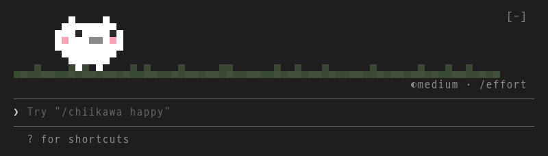
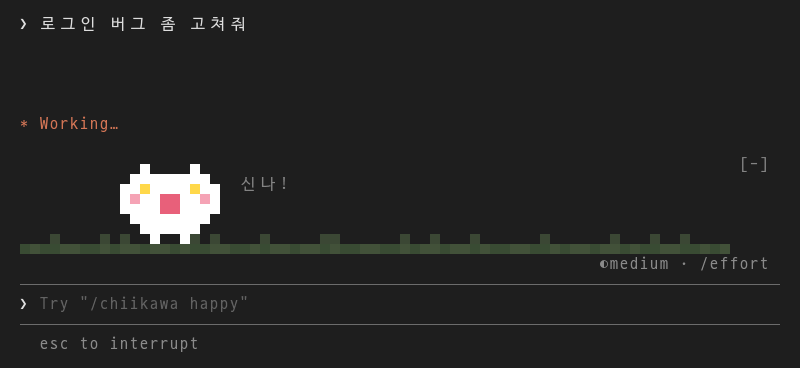
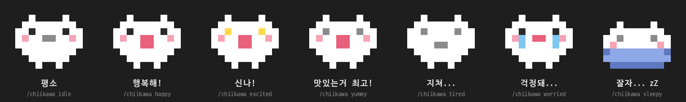

<div align="center">

# 🤍 치이카와 (Chiikawa · ちいかわ) for Claude Code

**Claude Code 입력 창 위, 작은 풀밭에 치이카와가 살아요.**

코딩하는 동안 옆에서 산책하고, 숨 쉬고, 같이 열일하고, 끝나면 기뻐해 줘요.

[한국어](#한국어) · [English](#english) · [日本語](#日本語)



</div>

> **비영리 목적의 팬 프로젝트 (Non-commercial fan project)**
> 치이카와를 좋아하는 마음으로 만든 비공식 팬 프로젝트예요. 상업적으로 이용하지 않으며, 치이카와의 모든 권리는 나가노 및 권리자에게 있어요.

---

## 한국어

### 이런 친구예요

|  |  |
| --- | --- |
| 🌱 **풀밭 위 산책** | 쉬는 동안 풀밭을 깡총깡총 걸어 다니다가 멈춰서 숨을 골라요. 눈과 입은 걸어가는 쪽을 봐요. |
| 💨 **숨 쉬는 모션** | 가만히 있을 때는 발을 땅에 붙인 채 배가 부풀었다 줄었다 해요. |
| 💪 **같이 열일** | Claude가 일하는 동안 제자리에서 빠르게 숨 쉬며 `열일 중...`을 띄워요. |
| 🎭 **표정 7가지** | 요청을 보내면 신나 하고, 끝나면 행복해하고, 오래 걸리면 지치고, 오류가 나면 눈물을 흘리며 걱정해요. |
| 🍙 **먹는 얘기엔 반응** | 밥·커피·간식 얘기를 하면 `맛있는거 최고!` |
| 😴 **낮잠** | 5분 동안 조용하면 파란 이불을 덮고 잠들어요. |
| 🌗 **테마 맞춤** | 풀밭은 쨍하지 않은 연한 색으로, 라이트/다크 테마 배경에 맞춰 섞여요. |

### 같이 일하는 모습

요청을 보내면 → 신나! → 열일 중... → 행복해!



### 표정 모음



`/chiikawa <표정>`으로 직접 바꿀 수도 있어요.

```
/chiikawa happy      /chiikawa excited    /chiikawa yummy
/chiikawa tired      /chiikawa worried    /chiikawa sleepy     /chiikawa idle
```

`sleepy`와 `idle`은 다른 표정으로 바뀔 때까지 유지되고, 나머지는 몇 초 뒤 평소 모습으로 돌아와요.

### 설치

Claude Code 터미널 세션의 입력 창에서:

```
/plugin install chiikawa --marketplace BBAAMM/claude-chiikawa
```

`Add marketplace?`에 `y`를 누르고, 설치 범위는 맨 위의 user를 Enter로 고르면 바로 치이카와가 나타나요.

셸에서 설치하려면:

```
claude plugin install chiikawa --marketplace BBAAMM/claude-chiikawa
```

데스크톱 앱에서는 (`/plugin`이 동작하지 않아요) 입력 창 옆 **+** → **Plugins** → **Add marketplace**에 `BBAAMM/claude-chiikawa` 입력 → **Add plugin**.

### 알아두면 좋은 점

- 치이카와는 입력 창 위 영역에만 그려져요. 그 아래의 `◐ medium · /effort` 줄과 입력 창 테두리는 Claude Code가 직접 그리는 부분이라 바뀌지 않아요.
- 풀밭 색은 터미널이 투명도를 지원하지 않아서, 테마 배경색과 미리 섞은 색이에요.
- 트루컬러를 지원하는 터미널에서 가장 예뻐요.

---

## English

**A tiny Chiikawa living on a strip of soft grass right above your Claude Code prompt.**

> **Non-commercial fan project.** Made out of love for Chiikawa. It is unofficial and not used for any commercial purpose.

### What it does

- 🌱 **Strolls** along the grass while you're idle, hopping a cell at a time, its eyes and mouth glancing the way it walks.
- 💨 **Breathes** in place when resting, feet planted, belly rising and falling.
- 💪 **Works with you**: quick breaths and a `열일 중...` ("hard at work...") caption while Claude is busy.
- 🎭 **Seven moods**: excited when you send a prompt, happy when the turn ends, tired after a long one, teary and worried on an error.
- 🍙 **Food talk** (rice, coffee, snacks…) makes it go `맛있는거 최고!` ("yummy is the best!").
- 😴 **Naps** under a blue blanket after 5 quiet minutes.
- 🌗 **Theme-aware grass**, softly blended into your light or dark background so Chiikawa stays the star.

Set a mood by hand with `/chiikawa <mood>`: `idle`, `happy`, `excited`, `yummy`, `tired`, `worried`, `sleepy`.

### Install

At the prompt of a Claude Code terminal session:

```
/plugin install chiikawa --marketplace BBAAMM/claude-chiikawa
```

Answer `y` to add the marketplace, then press Enter for the user scope.

From a shell:

```
claude plugin install chiikawa --marketplace BBAAMM/claude-chiikawa
```

In the desktop app, where `/plugin` does not run: click **+** next to the prompt box, then **Plugins**, **Add marketplace** with `BBAAMM/claude-chiikawa`, then **Add plugin**.

---

## 日本語

**Claude Code の入力欄の上、小さな草原にちいかわが住んでいます。**

> **非営利のファンプロジェクトです。** ちいかわが大好きな気持ちで作った非公式のファンメイド作品で、商用利用は一切していません。ちいかわに関するすべての権利はナガノ先生および権利者に帰属します。

### できること

- 🌱 **おさんぽ**: 待機中は草原をぴょこぴょこ歩き回ります。目と口は進む方向を向きます。
- 💨 **呼吸モーション**: じっとしているときは足を地面につけたまま、おなかがふくらんだりしぼんだりします。
- 💪 **いっしょにお仕事**: Claude が作業している間は、その場で速く呼吸しながら `열일 중...`（「お仕事中…」）と表示します。
- 🎭 **7つの表情**: プロンプトを送るとわくわく、終わるとにっこり、長引くとくたくた、エラーが出ると涙目で心配します。
- 🍙 **食べ物の話に反応**: ごはん・コーヒー・おやつの話をすると `맛있는거 최고!`（「おいしいもの最高！」）。
- 😴 **おひるね**: 5分間静かだと、青いおふとんをかけて眠ります。
- 🌗 **テーマに合わせた草原**: 草原はやわらかい色で、ライト／ダークテーマの背景になじみます。

`/chiikawa <表情>` で表情を手動で切り替えられます: `idle`, `happy`, `excited`, `yummy`, `tired`, `worried`, `sleepy`

### インストール

Claude Code のターミナルセッションの入力欄で:

```
/plugin install chiikawa --marketplace BBAAMM/claude-chiikawa
```

`Add marketplace?` に `y` を入力し、インストール範囲は一番上の user を Enter で選ぶと、すぐにちいかわが現れます。

シェルからインストールする場合:

```
claude plugin install chiikawa --marketplace BBAAMM/claude-chiikawa
```

デスクトップアプリでは（`/plugin` は動作しません）、入力欄の横の **+** → **Plugins** → **Add marketplace** に `BBAAMM/claude-chiikawa` を入力 → **Add plugin**。

---

<sub>The images above are rendered from the plugin's own sprite code on a dark theme. Non-commercial fan project: fan-made pixel art, unofficial and not for profit. Chiikawa belongs to Nagano and its rights holders. 이 프로젝트는 비영리 목적의 비공식 팬 프로젝트이며, 치이카와의 권리는 나가노 및 권리자에게 있어요.</sub>
